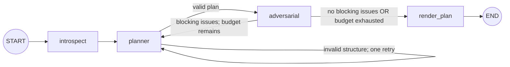
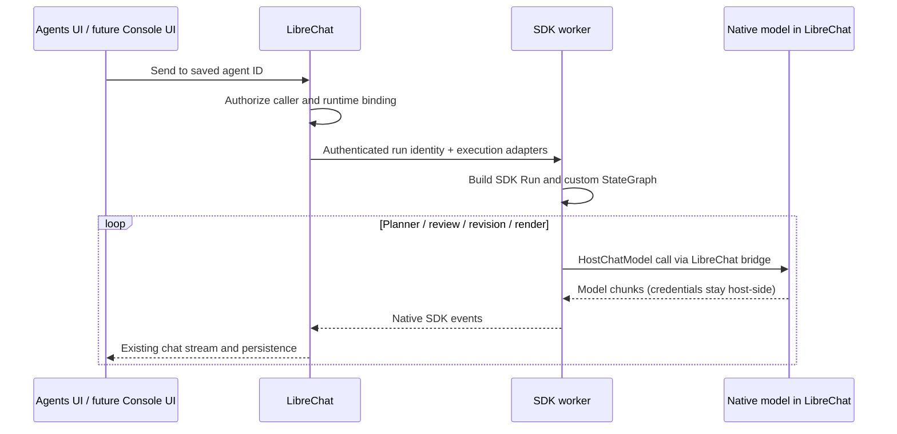

# Schema Advisor-shaped LangGraph in LibreChat

This example demonstrates the **graph integration**, not the Schema Advisor product. It uses
synthetic context and no ClickHouse connection, domain tools, DDL compiler, Cloud persistence,
benchmarking, or Temporal workflows. The graph, SDK Run, socket bridge, LibreChat UI and message
persistence are real. The default model is deliberately deterministic.

## The graph



[`schema-advisor.cjs`](schema-advisor.cjs) uses `Annotation.Root`, `messagesStateReducer`,
`StateGraph`, custom async nodes, conditional edges, and `.compile(compileOptions)`. It carries
the plan, issues, review-attempt count and structural-retry count in graph state. Info-only review
notes do not trigger revisions. Exhausted review attempts produce `needs_human_review`, never an
automatic approval. Structural validation here checks a small JSON contract; it is **not** the
real Schema Advisor SQL/dependency compiler.

The injected `callAgent` boundary plays the role of the domain graph's node dependencies. In
`createSchemaAdvisorRun`, it calls the SDK's compiled agent runnable. This preserves native model
events, tool/policy hooks, streaming limits and run-step handling instead of translating a second
streaming protocol. The outer graph retains both `messages` and `runStepState` in its checkpoint.
The factory preserves `input.config`, `input.signal`, and the supplied checkpointer. Checkpoint
interrupt names belong to the outer graph; they are not applied to the nested SDK graph's nodes.

This example uses the SDK checkout’s resolved LangChain/LangGraph versions. It does not import
the current private Schema Advisor package or its older LangChain dependency tree. When porting,
align those dependencies; matching class names do not guarantee cross-version object compatibility.

For a port, keep domain state, node dependencies, routing, and plan validation in the worker;
replace its hand-written model/tool loop with the SDK agent node. Do not just return an arbitrary
compiled StateGraph from the runtime factory: LibreChat expects a real SDK `Run`. Do not add a
second `streamEvents()` consumer: `Run.processStream()` owns event consumption.

## Model classes

[`schema-advisor-models.cjs`](schema-advisor-models.cjs) exposes the same `{ chat, fast }`
`BaseChatModel` boundary as Schema Advisor. It can construct `ChatAnthropic` (including an
Anthropic-compatible gateway URL) or `ChatBedrockConverse`, with different planner and reviewer
model names. The keyless `ExampleAdvisorModel` is a small `BaseChatModel` implementation with
`_generate`, `_streamResponseChunks` and `bindTools`; it intentionally omits validation on the
first plan, so the default example always exercises a real revision edge. Its token counts are
synthetic test data, not measured usage.

Two modes are explicit:

| Mode          | Model ownership                                                                                          | Current limitation                                                                                                                                                                                                                      |
| ------------- | -------------------------------------------------------------------------------------------------------- | --------------------------------------------------------------------------------------------------------------------------------------------------------------------------------------------------------------------------------------- |
| Worker models | Worker constructs `chat` / `fast` using the native classes                                               | Saved builder settings and host input/model protections are not automatically inherited. Worker credentials and provider access require operator configuration. This is an integration example, not a production parity claim.          |
| Host model    | LibreChat supplies `input.hostModel`; worker uses that `BaseChatModel`-compatible facade for every stage | The bridge currently exposes **one saved model**, so planner and reviewer use the same model. Independent host-owned `chat` / `fast` selection remains a gap. The worker never falls back to its own models when the host supplies one. |

The host-model facade serializes calls back to LibreChat, where its native provider class executes;
it does not serialize a JavaScript model object or give the worker provider credentials. In host
mode, select/configure Anthropic or Bedrock in LibreChat. Changing worker model environment
variables cannot override that saved selection. Host-authorized tool definitions are retained,
but this example needs no tools.

## Run it in real LibreChat

Use the build/start and runtime-secret instructions in [README.md](README.md). Merge
[`librechat.yaml`](librechat.yaml) into your configuration and start the worker:

```sh
SDK_EXAMPLE_GRAPH=schema-advisor node examples/sdk-runtime/server.cjs
```

Register a saved agent using the Management API (with its normal authenticated credentials):

```json
{
  "name": "Schema Advisor graph example",
  "provider": "anthropic",
  "model": "<model permitted by this LibreChat instance>",
  "sdk_runtime": { "id": "remote-example", "protocolVersion": 1 }
}
```

Select it in the normal Agents picker and send **“Investigate the reporting query and review the
proposal.”** With the deterministic model, you see the proposal, a review requesting validation,
the revised proposal, and “Reviewed example plan” with two review rounds. Reload to verify the
saved result. Intermediate model JSON is intentionally visible for inspecting this integration;
this example does not reproduce the Schema Advisor plan-card UI.

For native worker model classes, explicitly select one of these instead of the fixture:

```sh
SDK_EXAMPLE_GRAPH=schema-advisor SDK_ADVISOR_PROVIDER=anthropic \
  SDK_ADVISOR_PRIMARY_MODEL='<planner model>' SDK_ADVISOR_FAST_MODEL='<reviewer model>' \
  node examples/sdk-runtime/server.cjs
# Set ANTHROPIC_API_KEY in the worker environment; optionally SDK_ADVISOR_ANTHROPIC_URL.

SDK_EXAMPLE_GRAPH=schema-advisor SDK_ADVISOR_PROVIDER=bedrock AWS_REGION=us-east-2 \
  SDK_ADVISOR_PRIMARY_MODEL='<Bedrock planner model ID>' \
  SDK_ADVISOR_FAST_MODEL='<Bedrock reviewer model ID>' \
  node examples/sdk-runtime/server.cjs
# Use the worker's AWS credential chain. No credentials belong in prompts or saved graph state.
```

For **host-owned** inference, also enable `endpoints.agents.sdkHostModels: {}` and
`endpoints.agents.sdkRuntimes.remote-example.remote.hostModel: true`. See the parent README's
[host-model setup](README.md#use-the-saved-agents-host-model). Then no model key is needed in
the worker. Do not point a production Schema Advisor deployment at this example worker.

## How it connects



The operator config maps `remote-example` to a worker URL and shared secret. The saved agent holds
the binding ID; callers do not supply arbitrary worker URLs. The signed identity carries the
user, agent, conversation and run IDs. `SDK_RUNTIME_AGENT_IDS` can additionally restrict the
worker to specific saved agents. Production transport uses `wss://`; the example binds loopback.

LibreChat owns conversation history, event persistence and its checkpoint adapter. The worker
owns graph execution and domain state. A host checkpoint can reconstruct the graph; it does not
make arbitrary side effects transactional. Browser reload, transient socket recovery, restarting
a paused graph, and restarting an actively executing worker are different lifecycle cases.
The existing opt-in recovery setup reattaches a surviving Run; it is not Temporal durability.
Graph `interruptBefore` is tested as a checkpoint primitive, not presented as a native approval
card. Product approvals still need the SDK approval protocol and domain authorization.

Temporal benchmark/promotion workflows and the domain state store remain outside this example.
Replacing that orchestration, multi-model host selection, native artifacts, detached composition,
and full accounting/tracing policy inheritance require their own acceptance work. See the
[parity matrix](../../docs/sdk/agents.md#main-chat-parity-and-rollout-gates).

## Verification

```sh
npx jest --config api/jest.config.js api/test/schemaAdvisorRuntime.spec.js --runInBand --coverage=false
npx playwright test -c e2e/playwright.config.mock.ts e2e/specs/mock/remote-sdk.spec.ts \
  -g 'Schema Advisor graph' --workers=1
```

With the worker running in schema-advisor mode, compare the same graph locally and over the
bridge (five warm runs, excluding UI/provider/network inference latency):

```sh
SDK_EXAMPLE_GRAPH=schema-advisor SDK_BENCHMARK_HOST_MODEL=true \
  node examples/sdk-runtime/benchmark.cjs
```

The focused tests exercise actual SDK nodes, model-class construction, revision exhaustion,
malformed model outputs, cancellation, checkpoint reconstruction, and authenticated host-model
transport with no worker fallback. The browser test uses a **separate worker process** and real
LibreChat, checks the two-round result after reload, and attaches a screenshot and visible latency.
It uses deterministic inference; those timings are not live-model or WAN performance claims.
